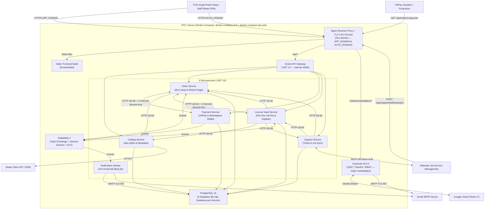

# Kiến trúc Tổng thể, Công nghệ & Kỹ thuật — Digital License Marketplace (DLM)

> Tài liệu hệ thống hóa toàn bộ kiến trúc, vai trò của từng công nghệ, cách chúng phối hợp và các kỹ thuật cốt lõi trong nhánh bàn giao `feat/customer-license-delivery` (`24385ad`), triển khai trực tiếp trên VPS bằng **Nginx + Let's Encrypt (đã bỏ Cloudflare)**.

---

## 1. Bức tranh kiến trúc tổng thể

Digital License Marketplace (DLM) được thiết kế theo kiến trúc **Microservices hướng sự kiện (Event-Driven SOA)** với 6 dịch vụ nghiệp vụ .NET 10 độc lập, giao tiếp đồng bộ qua HTTP nội bộ / API Gateway và bất đồng bộ qua RabbitMQ.

### Nguyên tắc phân tách mạng & bảo mật biên (không dùng Cloudflare)

- **Chỉ duy nhất Nginx mở ra Internet** ở cổng `80` (ACME HTTP-01 & redirect 301) và `443` (HTTPS TLS 1.2/1.3).
- **Toàn bộ dịch vụ còn lại nằm trong Docker network `backend`**:
  - `gateway` bị khóa về `127.0.0.1:8000` (qua `docker-compose.vps.yml`), không truy cập trực tiếp từ Internet.
  - `keycloak` bị khóa về `127.0.0.1:8081`; Nginx trên `AUTH_DOMAIN` **chặn cứng `/admin` và `/realms/master` (trả 403)**, chỉ cho phép các endpoint công khai của realm `marketplace`.
  - `postgres` không publish port ra host.
  - `rabbitmq` chỉ mở Management UI ở `127.0.0.1:15672`.

---

## 2. Công nghệ này làm gì? Công nghệ kia làm gì? Cách hoạt động

### 2.1. Frontend — React 19 + TypeScript + Vite 8 + `keycloak-js`

| Thành phần | File chính | Vai trò & cách hoạt động |
|---|---|---|
| **React 19 + TypeScript 7** | `frontend/src/App.tsx`, `frontend/src/pages/*` | Xây dựng giao diện SPA cho cả Customer (Storefront, Product Detail, Orders, My Licenses, Payment Result) và Staff (Admin Catalog, License Inventory, Import CSV/TXT, Suppliers/Kinguin, Transactions/Audit). |
| **React Router v7** | `frontend/src/App.tsx`, `frontend/src/auth/RoleGuard.tsx` | Định tuyến phía client; `RoleGuard` kiểm tra role trong JWT token trước khi render từng trang (không thay thế bảo mật backend, chỉ bảo vệ UX). |
| **Vite 8** | `frontend/vite.config.ts`, `frontend/package.json` | Dev server local (`localhost:5173`, proxy `/api` -> `127.0.0.1:8000`) và công cụ đóng gói bản production thành file tĩnh trong `frontend/dist/` để Nginx phục vụ trực tiếp. |
| **keycloak-js** | `frontend/src/auth/keycloak.ts`, `frontend/src/auth/AuthProvider.tsx` | Tích hợp OpenID Connect theo luồng **Authorization Code + PKCE (`S256`)**, `onLoad: "check-sso"`, tự gọi `updateToken(30)` để làm mới Access Token trước khi hết hạn và đính kèm `Authorization: Bearer <token>` trong `frontend/src/api/client.ts`. |

### 2.2. Reverse Proxy & HTTPS — Nginx + Let's Encrypt (Certbot)

> Thay thế hoàn toàn Cloudflare Tunnel.

| Thành phần | File chính | Vai trò & cách hoạt động |
|---|---|---|
| **Nginx (`nginx:stable-alpine`)** | `docker-compose.vps.yml`, `infra/nginx/vps/site-https.conf.template`, `infra/nginx/vps/bootstrap-http.conf.template` | Đóng 4 vai trò đồng thời: (1) **TLS Termination** cho cả `APP_DOMAIN` và `AUTH_DOMAIN`; (2) **Static Server** phục vụ `frontend/dist/` kèm SPA fallback (`try_files ... /index.html`); (3) **Edge Protection** giới hạn tốc độ (`limit_req_zone`), ép phương thức HTTP cho VNPay IPN (`GET` only, `access_log off` để không lộ `vnp_SecureHash`) và Jira Webhook (`POST` only, `client_max_body_size 16k`), chặn `/admin` của Keycloak; (4) **Reverse Proxy** chuyển `/api/*` tới `gateway:8080` và `/realms/marketplace/*` tới `keycloak:8080` kèm header `X-Forwarded-Proto/Host/Port`. |
| **Certbot (Let's Encrypt)** | `docker-compose.vps.yml`, `scripts/init-vps-tls.sh` | Tự động xin và gia hạn chứng chỉ TLS miễn phí cho cả `APP_DOMAIN` và `AUTH_DOMAIN` bằng thử thách **ACME HTTP-01** thông qua volume chung `certbot_webroot` (`/var/www/certbot`) mà không cần dừng hệ thống khi gia hạn. |

### 2.3. API Gateway — Ocelot (.NET 10)

| Thành phần | File chính | Vai trò & cách hoạt động |
|---|---|---|
| **Ocelot API Gateway** | `gateway/Program.cs`, `gateway/ocelot.json` | Cổng vào duy nhất cho mọi API `/api/*`. Định tuyến URL từ bên ngoài (Upstream) vào đúng microservice nội bộ (Downstream): - `/api/catalog/products/*` → `catalog:8080/api/products/*` - `/api/catalog/steam-import*` → `catalog:8080/api/steam-import*` - `/api/orders/*` → `order:8080/api/orders/*` - `/api/orders/vnpay-ipn` (Priority `1`) → `payment:8080/api/orders/vnpay-ipn` - `/api/wallet/me*` → `payment:8080/api/wallet/me*` - `/api/licenses/*` → `license-vault:8080/api/licenses/*` - `/api/support/tickets*` & `/api/support/webhooks/jira` → `support:8080/api/support/*` Ngoài ra `gateway/Program.cs` chạy middleware **CORS** trước `UseOcelot()` để xử lý request preflight `OPTIONS` từ `FRONTEND_PUBLIC_URL`. |

### 2.4. Hệ thống Định danh & Phân quyền — Keycloak 26.8.2

| Thành phần | File chính | Vai trò & cách hoạt động |
|---|---|---|
| **Keycloak** | `infra/keycloak/marketplace-realm.json`, `scripts/configure-roles.sh`, `scripts/configure-auth.sh`, `scripts/configure-vps-auth.sh` | Máy chủ định danh tập trung (**Identity Provider — IdP**) theo chuẩn **OIDC / OAuth2**. Quản lý tài khoản người dùng, đăng ký mới, mật khẩu, bảo vệ brute-force, chống trùng email (`duplicateEmailsAllowed=false`), cấp phát JWT ký bằng khóa bất đối xứng **RS256**, đồng thời làm **Identity Broker** kết nối Google OAuth 2.0. |
| **JWT Validation ở Backend** | `shared/Infrastructure/Security/KeycloakAuthentication.cs` | Tách biệt 2 địa chỉ quan trọng để chạy tốt sau Reverse Proxy: - `Keycloak:MetadataAddress`: dùng địa chỉ nội bộ Docker (`http://keycloak:8080/realms/marketplace/.well-known/openid-configuration`) để tải khóa công khai JWKS nhanh, không phải đi vòng ra Internet. - `Keycloak:Issuer`: khớp chính xác domain công khai (`https://<AUTH_DOMAIN>/realms/marketplace`) ghi trong trường `iss` của JWT. Sự kiện `OnTokenValidated` đọc mảng `realm_access.roles` trong JWT rồi ánh xạ thành `ClaimTypes.Role` để ASP.NET Core `[Authorize(Policy = ...)]` kiểm tra. |

**Ma trận 5 Role nghiệp vụ (RBAC):**

| Role | Phạm vi quyền | Quy tắc đặc biệt |
|---|---|---|
| `customer` | Mua hàng, xem đơn của mình, xem/reveal license của mình, xem ví Wallet, mở ticket hỗ trợ. | Tự động gán làm default role cho user đăng ký mới hoặc login Google. |
| `catalog_manager` | CRUD sản phẩm, quản lý ẩn/hiện, import metadata Steam/IGDB. | Staff **không được dùng chức năng mua hàng của Customer** (`CustomerOnly` chặn mọi role staff/admin). |
| `license_coordinator` | Quản lý kho key, nhập key thủ công / CSV / TXT, quản lý nhà cung cấp, chạy Kinguin Mock, xử lý ticket về key và đổi key (`LicenseReplacement`). | Không xem được plaintext key trong danh sách quản lý kho. |
| `transaction_auditor` | Kiểm tra giao dịch, xử lý ticket về thanh toán/hoàn tiền, khởi tạo/duyệt hoàn tiền. | Phụ trách các ticket loại `PAYMENT_ISSUE`, `REFUND_REQUEST`, `OTHER`. |
| `admin` | Role tương thích legacy. | Tách khỏi `CustomerOnly`. |

### 2.5. 6 Microservices nghiệp vụ (.NET 10 / ASP.NET Core / EF Core)

| Service | Thư mục | DB riêng | Trách nhiệm chính |
|---|---|---|---|
| **Catalog Service** | `services/catalog-service` | `catalog_db` | Quản lý danh mục game (`products`), tìm kiếm/phân trang, quản lý trạng thái ẩn/hiện, lấy metadata game từ **Steam Store API** (có fallback **IGDB** nếu cấu hình). |
| **Order Service** | `services/order-service` | `order_db` | Tạo đơn hàng (kiểm tra sản phẩm từ Catalog + tồn kho từ License Vault), khởi tạo phiên thanh toán VNPay hoặc trừ ví Wallet qua Payment Service, nhận sự kiện thanh toán & cấp key qua RabbitMQ, điều phối hoàn tiền (**Refund Saga** qua `RefundWorker` + `RefundOrchestrator`). |
| **Payment Service** | `services/payment-service` | `payment_db` | Tạo URL thanh toán VNPay có chữ ký HMAC-SHA512, tiếp nhận & xác thực **VNPay IPN**, quản lý **Marketplace Wallet** (số dư, lịch sử giao dịch, thanh toán bằng ví, cộng tiền hoàn), phát sự kiện `payment.succeeded` / `payment.failed` / `payment.refunded` qua Outbox. |
| **License Vault Service** | `services/license-vault-service` | `license_db` | Két sắt bảo mật chứa License Key: mã hóa AES-256-GCM, chống trùng bằng HMAC-SHA256 fingerprint, nhập kho thủ công/CSV/TXT theo lô (`license_import_batches`), quản lý nhà cung cấp (`suppliers`, `supplier_api_configurations`, `supplier_product_mappings`), tích hợp **Kinguin Mock** & Auto-Import demo, cấp phát key tự động khi nhận `order.paid`, cho khách hàng **reveal** key an toàn, đổi key lỗi (`LicenseReplacement`), khóa bảo vệ hoàn tiền (`LicenseRefundGuard`). |
| **Support Service** | `services/support-service` | `support_db` | Quản lý phiếu hỗ trợ khách hàng (`support_tickets`, `support_messages`), tự động phân tuyến theo loại sự cố (`license_coordinator` vs `transaction_auditor`), xác minh quyền sở hữu đơn/key trước khi tạo ticket, liên kết & đồng bộ 2 chiều với **Jira Service Management** (`support_external_links`, `JiraClient`, `JiraWebhookController`), kiểm tra điều kiện đổi key/hoàn tiền cho License Vault & Order. |
| **Notification Worker** | `services/notification-service` | `notification_db` | Background Worker không mở HTTP API; lắng nghe `order.completed` và `order.refunded` từ RabbitMQ, ghi vào bảng `notification_messages` (chống trùng theo `(OrderId, Type)`), rồi dùng `EmailWorker` gửi email qua **Gmail SMTP** với cơ chế retry backoff. **Tuyệt đối không gửi plaintext license key trong email.** |

### 2.6. Cơ sở dữ liệu — PostgreSQL 16 (Database-per-Service)

Một cụm `postgres:16` nhưng tách thành **6 database độc lập** (`infra/postgres/init.sql`) để các service không bao giờ truy cập trực tiếp bảng của nhau:

| Database | Các bảng chính | Quản lý Schema |
|---|---|---|
| `catalog_db` | `products` | EF Core Migrations (`migrator catalog`) |
| `order_db` | `orders`, `order_items`, `outbox_messages`, `fulfillment_results`, `refund_operations` | EF Core Migrations (`migrator order`) |
| `payment_db` | `payments`, `refunds`, `wallets`, `wallet_transactions`, `outbox_messages` | EF Core Migrations (`migrator payment`) |
| `license_db` | `license_keys`, `license_import_batches`, `suppliers`, `supplier_api_configurations`, `supplier_product_mappings`, `allocation_results`, `license_refund_guards`, `license_replacements`, `kinguin_mock_orders` | EF Core Migrations (`migrator license`) |
| `support_db` | `support_tickets`, `support_messages`, `support_external_links` | SQL idempotent (`infra/postgres/support.sql` qua `scripts/migrate-support.sh`) |
| `notification_db` | `notification_messages` | SQL idempotent (`infra/postgres/notification.sql` qua `scripts/migrate-notification.sh`) |

> **Lưu ý vận hành:** Không service nào chạy `EnsureCreated()` hay auto-migrate lúc khởi động. Mọi migration EF Core được tách sang container riêng `migrator` (`infra/migrations/Dockerfile`, `scripts/migrate.sh`) để tách biệt quyền thay đổi schema khỏi quyền chạy ứng dụng.

### 2.7. Message Broker — RabbitMQ 3 (Topic Exchange + Quorum Queues + DLX)

| Khái niệm | Cấu hình thực tế trong DLM | Tác dụng |
|---|---|---|
| **Topic Exchange** | `marketplace.events` (durable) | Định tuyến sự kiện dựa trên `routingKey` (`payment.succeeded`, `order.paid`, `key.assigned`, `key.out_of_stock`, `order.completed`, `order.refunded`, `kinguin.mock.payment-confirmed`). |
| **Quorum Queues** | `x-queue-type: quorum` cho `license-vault.order-paid`, `order.license-events`, `order.payment-events`, `notification.order-events`, `license-vault.kinguin-mock-payment` | Đảm bảo độ bền cao (Raft-based), hỗ trợ chính sách giới hạn số lần giao lại (`delivery-limit`). |
| **Retry & Dead Letter Exchange (DLX)** | `scripts/configure-rabbitmq.sh`: `delivery-limit: 5`, `dead-letter-exchange: marketplace.events.dead`, `dead-letter-strategy: at-least-once`, `overflow: reject-publish` | Nếu message lỗi liên tục quá 5 lần sẽ tự động đẩy sang Dead Letter Queue để điều tra, không làm nghẽn hoặc vòng lặp vô hạn queue chính. |
| **Publisher Confirms & Manual Ack** | `shared/Infrastructure/Messaging/RabbitMqPublisher.cs` (`publisherConfirmationsEnabled: true`), consumer `autoAck: false` | Đảm bảo broker thực sự đã ghi nhận message trước khi đánh dấu Outbox đã gửi, và chỉ `BasicAck` sau khi consumer commit xong database. |

---

## 3. Các kỹ thuật độ tin cậy & bảo mật cốt lõi trong mã nguồn

Đây là những điểm kỹ thuật quan trọng nhất giúp DLM tránh mất tiền, tránh cấp trùng key và chống rò rỉ dữ liệu:

### 3.1. Transactional Outbox Pattern (Chống mất sự kiện khi RabbitMQ sập)

- **Vấn đề:** Nếu cập nhật DB thành `PAID` rồi mới gọi `RabbitMQ.Publish()`, khi app crash hoặc RabbitMQ mất kết nối ở giữa chừng, đơn đã trừ tiền nhưng sẽ không bao giờ được cấp key.
- **Cách DLM giải quyết:** Trong **cùng một DB transaction**, Payment Service (`outbox_messages`), Order Service (`outbox_messages`) và License Vault (`allocation_results`) vừa cập nhật trạng thái nghiệp vụ vừa ghi bản ghi sự kiện cần gửi. Một background worker (`OutboxWorker` / `AllocationOutboxWorker` chạy vòng lặp `shared/Infrastructure/Messaging/OutboxLoop.cs`) đọc từng bản ghi chưa gửi, publish lên RabbitMQ (có publisher confirm), lỗi thì retry theo exponential backoff `RetryDelay.Seconds(attempt) = 2^attempt` (tối đa 256s).

### 3.2. Idempotency & Chống xử lý trùng lặp

Vì mạng hoặc RabbitMQ luôn có thể giao lại thông điệp (**at-least-once delivery**), mọi bước quan trọng đều bất biến khi chạy lại:
- **Payment IPN:** Kiểm tra `VnpTransactionNo`, `Payment.Status` và khóa advisory lock `vnpay:transaction:{txNo}` — callback lặp trả `RspCode = 02` mà không ghi đè hay phát lại sự kiện.
- **License Allocation:** Lưu `allocation_results` với khóa chính `OrderId` và `RequestFingerprint` (SHA-256 của payload đã chuẩn hóa thứ tự `ItemId`). Nếu nhận lại cùng `order.paid`, bỏ qua an toàn; nếu payload xung đột cho cùng `OrderId`, ném ngoại lệ để phát hiện bất thường.
- **Order Fulfillment:** Lưu `fulfillment_results` với khóa chính `OrderId`, so sánh payload tương đương ngữ nghĩa (kể cả khi `jsonb` đổi thứ tự thuộc tính).
- **Notification:** Ràng buộc `UNIQUE ("OrderId", "Type")` trên `notification_messages` đảm bảo mỗi đơn chỉ gửi tối đa 1 email `COMPLETED` và 1 email `REFUNDED`.
- **License Replacement:** Khóa chính `TicketId` trên `license_replacements` đảm bảo 1 ticket chỉ đổi tối đa 1 lần.

### 3.3. Khóa đồng thời (Concurrency Control) & Chống Deadlock

- **Row-level locking (`SELECT ... FOR UPDATE`):** Dùng khi trừ số dư ví (`wallets`), chọn key trống (`license_keys`), xác nhận đơn hàng (`orders`), khóa IPN (`payments`).
- **Worker queue không tranh chấp (`FOR UPDATE SKIP LOCKED`):** Dùng trong `RefundOrchestrator` (`refund_operations`) và `EmailWorker` (`notification_messages`) để nhiều worker có thể xử lý song song mà không chặn nhau.
- **Transaction Advisory Lock (`pg_advisory_xact_lock(hashtextextended(key, 0))`):**
  - `LicenseOrderLock` trong License Vault đồng bộ hóa giữa **Cấp key**, **Reveal key**, **Đổi key** và **Hoàn tiền** cho cùng một `OrderId` — ngăn tuyệt đối tình huống khách vừa bấm Reveal key vừa được duyệt Hoàn tiền cùng mili-giây!
  - `fulfillment:{orderId}`, `payment:{orderId}`, `replacement:{ticketId}`, `kinguin-mock-stock:{supplierProductId}` đảm bảo tính tuần tự cho từng tài nguyên.
- **Chống Deadlock khi cấp nhiều sản phẩm:** `LicenseAllocationService` luôn sắp xếp `OrderBy(g => g.Key)` (`ProductId`) trước khi `SELECT ... FOR UPDATE`, đảm bảo mọi transaction khóa theo một thứ tự toàn cục duy nhất.

### 3.4. Mã hóa License Key tại License Vault (AES-256-GCM + HMAC-SHA256)

Xem `services/license-vault-service/Infrastructure/Security/LicenseEncryption.cs`:
- **Hai khóa 32-byte tách biệt bắt buộc khác nhau:** `LICENSE_ENCRYPTION_KEY` và `LICENSE_FINGERPRINT_KEY`.
- **Mã hóa (`Encrypt`):** Dùng **AES-256-GCM** (Authenticated Encryption) với `12-byte random nonce`, `16-byte authentication tag`, và `AAD = [FormatVersion (0x01)]`. Chuỗi lưu trong cột `EncryptedKey` có cấu trúc Base64 của `[1B version | 12B nonce | 16B tag | ciphertext]`. Bộ nhớ đệm plaintext được xóa ngay bằng `CryptographicOperations.ZeroMemory()`.
- **Chống nhập trùng (`Fingerprint`):** Tính `HMAC-SHA256(LICENSE_FINGERPRINT_KEY, plaintext.Trim())` lưu vào cột `KeyFingerprint` (có `UNIQUE INDEX`). Nhờ đó hệ thống phát hiện key trùng lập tức mà **không cần lưu plaintext hay giải mã toàn bộ kho**.
- **Bảo vệ khi giao key:** Không bao giờ đưa plaintext key vào RabbitMQ (`AssignedKey` chỉ chứa `LicenseId`), không đưa vào email, và `CustomerLicensesController` luôn gắn `Cache-Control: no-store`, ghi `RevealedAtUtc` và commit DB **trước** khi trả plaintext cho trình duyệt.

> **Cảnh báo vận hành:** Không bao giờ tự sinh lại `LICENSE_ENCRYPTION_KEY` hoặc `LICENSE_FINGERPRINT_KEY` khi giữ nguyên `license_db` — mất khóa này sẽ không thể giải mã các key đã nhập kho.

### 3.5. Bảo mật liên dịch vụ & Webhook bên ngoài

- **Internal Service-to-Service Auth (`shared/Infrastructure/Security/InternalServiceAuth.cs`):** Các API nội bộ (`/api/internal/*` giữa Order, Payment, License Vault) bắt buộc có header `X-Internal-Service-Key` (từ `PAYMENT_INTERNAL_KEY`, tối thiểu 32 ký tự), so sánh bằng `CryptographicOperations.FixedTimeEquals` để chống timing attack.
- **VNPay IPN (`VnPayService.cs` & `VnPayIpnController.cs`):** Từ chối query có key trùng lặp (`RspCode = 97`), xác thực chữ ký **HMAC-SHA512** trên toàn bộ tham số `vnp_*` đã sắp xếp từ điển bằng `FixedTimeEquals`, đối chiếu `vnp_TmnCode` và `vnp_Amount == TotalAmount * 100`.
- **Jira Webhook — Mô hình Signal + Pull-to-Verify (`JiraWebhookController.cs`):** Xác thực header `X-DLM-Webhook-Secret` (>= 32 ký tự, so sánh SHA-256 constant-time), chỉ nhận `issueId` dạng số tối đa 4KB. **Không bao giờ tin nội dung trạng thái hay bình luận gửi trong webhook body**, mà gọi ngược sang Jira REST API bằng `JiraClient` để kéo trạng thái và comment công khai chính thức về DB!

---

## 4. Bản đồ tài liệu liên quan

| Tài liệu | Nội dung |
|---|---|
| [`docs/SYSTEM_FLOWS.md`](SYSTEM_FLOWS.md) | Sơ đồ tuần tự (Mermaid) và phân tích từng bước cho toàn bộ 9 luồng nghiệp vụ & RabbitMQ Topology. |
| [`docs/EXTERNAL_INTEGRATIONS_GUIDE.md`](EXTERNAL_INTEGRATIONS_GUIDE.md) | Hướng dẫn cấu hình thực tế cho Google OAuth + Keycloak, Jira Service Management, VNPay Sandbox và Gmail SMTP trên VPS Nginx (không Cloudflare). |
| [`docs/PARTNER_API_DESIGN.md`](PARTNER_API_DESIGN.md) | Đề xuất thiết kế **Partner ID & Partner API (B2B)** để nhóm duyệt trước khi sửa vùng dùng chung (Keycloak/Gateway). |
| [`docs/INFRASTRUCTURE_HANDOVER.md`](INFRASTRUCTURE_HANDOVER.md) | Checklist triển khai VPS trực tiếp bằng Nginx + Let's Encrypt, bàn giao credentials và tiêu chí nghiệm thu. |
| [`docs/DLM_DEVELOPMENT_HANDOVER.md`](DLM_DEVELOPMENT_HANDOVER.md) | Tiến độ phát triển ứng dụng, phân công tránh conflict và roadmap các hạng mục tiếp theo. |
| [`docs/DATABASE_MIGRATIONS.md`](DATABASE_MIGRATIONS.md) | Quy trình EF Core migrations an toàn cho từng database. |
