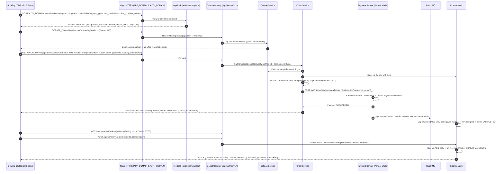

# Đề xuất Thiết kế: Partner ID & Partner API (B2B Integration)

> **Trạng thái:** **ĐÃ DUYỆT THIẾT KẾ — ĐANG TRIỂN KHAI TRÊN NHÁNH `feat/partner-api`**  
> Quy ước chốt với nhóm:
> 1. **Xác thực (Auth):** Chốt **Phương án A** — Keycloak OAuth2 `client_credentials` + realm role `partner_api` + protocol mapper claim `partner_id`.
> 2. **Nhận kết quả đơn hàng:** Hỗ trợ **cả Polling** (`GET /api/partner/v1/orders/{id}` + `POST /api/partner/v1/orders/{id}/licenses/claim`) **và Outbound Webhook ký HMAC-SHA256** (`partner.order.completed`, `partner.order.refunded`) có thể bắn trực tiếp về homeserver (`khenserver`). Tuyệt đối không đưa plaintext key vào payload webhook.
> 3. **Nạp số dư Partner Wallet:** API quản trị dành riêng cho role **`transaction_auditor`** (`POST /api/partner-admin/wallets/{partnerId}/topups`, bắt buộc `Idempotency-Key`, ghi sổ cái loại `TOPUP`).
> 4. **Nhánh triển khai:** Triển khai ngay trên nhánh riêng **`feat/partner-api`**.

---

## 1. Mục tiêu & Phân biệt rõ `Supplier` vs `Partner`

Để tránh nhầm lẫn nghiệp vụ trong mã nguồn hiện tại:

| Khái niệm | Hướng giao dịch | Vai trò trong DLM | Trạng thái hiện tại |
|---|---|---|---|
| **Supplier** (Nhà cung cấp đầu vào) | **DLM mua key từ ngoài** (ví dụ Kinguin Mock / nhà phân phối file CSV) | Cung cấp nguồn hàng nhập vào `license_db` | Đã có (`suppliers`, `supplier_api_configurations`, `supplier_product_mappings`, Kinguin Mock) |
| **Partner** (Đối tác B2B đầu ra) | **Hệ thống bên ngoài gọi API vào DLM để mua & nhận key tự động** (reseller, website/app đối tác, hệ thống tặng thưởng) | Khách hàng tổ chức giao tiếp máy-máy (M2M) qua **Partner ID** và **Partner API** | **Đề xuất thiết kế trong tài liệu này** |

---

## 2. Thiết kế Định danh (`Partner ID`) & Xác thực (Authentication)

### 2.1. Quy ước `Partner ID`
- Mỗi đối tác B2B được cấp một mã định danh duy nhất, bất biến: **`PartnerId`** dạng `prt_<slug-ngắn-hoặc-ulid>` (ví dụ: `prt_acme_store` hoặc UUID chuẩn hóa, tối đa 64 ký tự `[a-z0-9_-]`).
- `PartnerId` dùng để:
  1. Cô lập dữ liệu (**tenant/owner isolation**): đối tác chỉ thấy đơn hàng, ví trả trước và license thuộc đúng `PartnerId` của mình.
  2. Giới hạn lưu lượng (rate-limiting), theo dõi audit log và đối soát doanh thu theo từng đối tác.
  3. Ngăn đối tác gọi nhầm vào API của Customer trình duyệt hoặc API nội bộ của Staff.

### 2.2. So sánh 2 phương án xác thực & Đề xuất

| Tiêu chí | Phương án A (Khuyến nghị): Keycloak OAuth2 `client_credentials` + Claim `partner_id` | Phương án B (Tùy chọn bổ sung): Header `X-Partner-Id` + `X-Api-Key` |
|---|---|---|
| **Cơ chế** | Mỗi Partner có 1 **Confidential Client** trên Keycloak (`serviceAccountsEnabled: true`). Partner gửi `client_id` + `client_secret` lấy JWT ngắn hạn (5–15 phút). Keycloak gắn sẵn claim `partner_id` và role `partner_api` vào JWT. | Partner gửi trực tiếp 2 header `X-Partner-Id` và `X-Api-Key` trên mọi request. Gateway/Auth middleware băm `HMAC-SHA256(key)` đối chiếu bảng `partner_api_keys` (không lưu plaintext). |
| **Tương thích kiến trúc DLM** | **Rất cao** — tái sử dụng 100% `shared/Infrastructure/Security/KeycloakAuthentication.cs` ở mọi microservice mà không cần viết lại token engine. | Cần thêm bảng `partner_api_keys` + custom auth middleware ở Gateway + ký chuyển tiếp danh tính xuống downstream. |
| **Bảo mật** | Chuẩn OAuth2 M2M, token ngắn hạn tự hết hạn, xoay `client_secret` hoặc disable client tức thì ngay trong Keycloak. | Static secret đi theo từng request; nếu lộ key phải thu hồi thủ công; cần thêm HMAC timestamp nếu muốn chống replay. |
| **Độ đơn giản (KISS)** | Tối ưu nhất cho đồ án SOA đã dùng sẵn Keycloak. | Nhiều code custom hơn, tăng diện tích bảo mật cần audit. |

> **Đề xuất chốt:** Chọn **Phương án A (Keycloak `client_credentials` + Protocol Mapper nhúng `partner_id`)** cho Phase 1.  
> Cấu hình mẫu cho một Partner trong Keycloak realm `marketplace`:
> - `clientId`: `partner-<slug>` (ví dụ `partner-acme`)
> - `publicClient`: `false`, `standardFlowEnabled`: `false`, `directAccessGrantsEnabled`: `false`, `serviceAccountsEnabled`: `true`
> - Service Account được gán realm role: `partner_api`
> - **Hardcoded Claim Protocol Mapper** trên client: `partner_id = prt_acme` (đưa vào Access Token) + optional `partner_scopes = ["catalog:read", "orders:write", "licenses:claim"]`.

### 2.3. Chính sách phân quyền (Authorization Policy)

Bổ sung policy mới **`PartnerApiOnly`** song song với `CustomerOnly` (không làm thay đổi hành vi của `CustomerOnly`, `CatalogManagerOnly`, `LicenseCoordinatorOnly`, `TransactionAuditorOnly`):
- Yêu cầu JWT hợp lệ (issuer khớp `KEYCLOAK_PUBLIC_URL`), có role `partner_api`, có claim `partner_id` hợp lệ, và **KHÔNG** có các role staff/admin/customer.
- Quy tắc phòng thủ chéo:
  - Token `partner_api` gọi `/api/orders`, `/api/licenses/me`, `/api/support/*`, `/api/catalog/products/manage` -> bị từ chối `403 Forbidden`.
  - Token `customer` hoặc staff gọi `/api/partner/v1/*` -> bị từ chối `403 Forbidden`.

---

## 3. Luồng hoạt động End-to-End của Partner API

Vì giao tiếp Partner là **máy-máy (M2M)**, Partner **không thể đi qua trang redirect trình duyệt của VNPay**. Do đó luồng thanh toán chuẩn cho B2B là **Partner Prepaid Balance (Ví trả trước của Partner)** — tái sử dụng nguyên vẹn cơ chế trừ ví nguyên tử + Outbox + RabbitMQ hiện có của `payment-service` và `order-service`!



---

## 4. Hợp đồng API Đề xuất (`/api/partner/v1/*`)

Tất cả endpoint dưới `/api/partner/v1/*` đều yêu cầu `Authorization: Bearer <Partner JWT>` và trả JSON chuẩn, `Cache-Control: no-store` đối với dữ liệu đơn hàng/license.

| Method | Upstream Path (Gateway) | Downstream Service | Mục đích & Ràng buộc chính |
|---|---|---|---|
| `GET` | `/api/partner/v1/catalog/products` | `catalog` | Liệt kê sản phẩm `IsActive = true` (phân trang, tìm kiếm, trả kèm `availableStock`). |
| `GET` | `/api/partner/v1/catalog/products/{id}` | `catalog` | Xem chi tiết 1 sản phẩm và tồn kho hiện có. |
| `GET` | `/api/partner/v1/wallet/balance` | `payment` | Xem số dư ví trả trước (`balanceVnd`) và giao dịch gần đây của `partner:<partner_id>`. |
| `POST` | `/api/partner/v1/orders` | `order` | Tạo và thanh toán đơn B2B từ ví trả trước. **Bắt buộc header `Idempotency-Key`** (UUID/chuỗi 16–64 ký tự): gọi lại cùng `Idempotency-Key` + cùng payload trả lại đơn cũ; khác payload trả `409 IDEMPOTENCY_CONFLICT`. Giới hạn `quantity` (ví dụ 1–10 mỗi đơn, khớp `LicenseAllocationService.Validate`). |
| `GET` | `/api/partner/v1/orders/{id}` | `order` | Kiểm tra trạng thái đơn (`PENDING`, `PAID`, `COMPLETED`, `REFUNDING`, `REFUNDED`, `CANCELED`), chỉ trả đơn thuộc `partner_id` hiện tại. |
| `POST` | `/api/partner/v1/orders/{id}/licenses/claim` | `license-vault` | Nhận plaintext key của đơn `COMPLETED` thuộc `partner_id`. Khóa `LicenseOrderLock`, kiểm tra `LicenseRefundGuard`, ghi `RevealedAtUtc` và commit DB trước khi trả key. An toàn khi Partner retry gọi lại cùng `orderId` (trả lại đúng các key đã gán cho đơn đó, không cấp thêm key mới). |

### Ví dụ Request/Response `POST /api/partner/v1/orders`

```http
POST /api/partner/v1/orders HTTP/1.1
Host: marketplace.example.com
Authorization: Bearer <partner_jwt>
Idempotency-Key: 9b1deb4d-3b7d-4bad-9bdd-2b0d7b3dcb6d
Content-Type: application/json

{
  "productId": "3fa85f64-5717-4562-b3fc-2c963f66afa6",
  "quantity": 2,
  "externalReference": "ACME-ORD-2026-00042"
}
```

```json
{
  "orderId": "c2f8a1e0-1234-4abc-9def-0123456789ab",
  "partnerId": "prt_acme",
  "externalReference": "ACME-ORD-2026-00042",
  "status": "PAID",
  "totalAmount": 500000,
  "currency": "VND",
  "createdAtUtc": "2026-11-28T06:00:00Z"
}
```

---

## 5. Mô hình Dữ liệu Đề xuất (Không phá Schema cũ)

Thiết kế tối giản để giảm thiểu migration và tránh xung đột nhánh ứng dụng:

1. **Tại `order_db` (mở rộng có kiểm soát hoặc bảng phụ `partner_orders`):**
   - Cách ít xung đột nhất: thêm bảng riêng **`partner_order_requests`** trong `order_db` (liên kết 1-1 với `orders.Id`):
     - `PartnerId` (`varchar(64)`, NOT NULL)
     - `IdempotencyKey` (`varchar(64)`, NOT NULL)
     - `RequestHash` (`varchar(64)`, NOT NULL — SHA-256 của `{productId, quantity, externalReference}`)
     - `ExternalReference` (`varchar(128)`, NULL)
     - `OrderId` (`uuid`, NOT NULL, UNIQUE, FK -> `orders.Id`)
     - `CreatedAtUtc` (`timestamptz`, NOT NULL)
     - **Unique Index:** `UNIQUE ("PartnerId", "IdempotencyKey")`
   - Trong bảng `orders`, trường `KeycloakUserId` lưu giá trị chuẩn hóa **`partner:<partner_id>`** (ví dụ `partner:prt_acme`, khớp độ dài `varchar(64)` hiện có!).
   - **Lợi ích lớn:** Toàn bộ luồng RabbitMQ (`OrderPaidEvent`, `KeyAssignedEvent`, `KeyOutOfStockEvent`), `LicenseAllocationService`, `WalletPaymentService` và `RefundOrchestrator` **hoạt động gần như nguyên vẹn** vì cùng sử dụng chủ thể `partner:<partner_id>` mà không phải phá hợp đồng event `shared/Contracts`!
2. **Tại `payment_db`:**
   - Ví trả trước của đối tác dùng ngay bảng `wallets` với `CustomerId = "partner:<partner_id>"`.
   - Bổ sung API nội bộ/quản trị (dành cho `transaction_auditor` hoặc script seed demo) để nạp số dư thử nghiệm cho Partner Wallet (có ghi rõ dòng `WalletTransaction` kiểm toán).
3. **Tại `license_db`:**
   - Không cần đổi bảng `license_keys`! `CustomerId` sẽ lưu `partner:<partner_id>`, đảm bảo tách biệt hoàn toàn khỏi UUID `sub` của khách hàng cá nhân.
   - Endpoint `POST /api/partner/v1/orders/{id}/licenses/claim` kiểm tra `key.CustomerId == $"partner:{partnerId}"` và xác minh đơn `COMPLETED` với Order Service.
4. **Quản trị danh sách Partner (Phase 2 — tùy chọn):**
   - Nếu cần UI quản lý Partner ngoài Keycloak: thêm bảng `partners` (chứa `PartnerId`, `Name`, `KeycloakClientId`, `IsActive`, `WebhookUrl`, `WebhookSecretEncrypted`, `RateLimitPerMinute`). Ở Phase 1 MVP có thể quản lý trực tiếp bằng script provisioning `scripts/provision-partner.sh` qua Keycloak `kcadm.sh`.

---

## 6. Bảo mật & Chống lạm dụng cho Partner API

1. **Cách ly tuyệt đối giữa Partner và Customer/Staff:** Prefix `partner:<partner_id>` không bao giờ trùng với Keycloak user UUID (`sub`), cộng thêm policy `[Authorize(Policy = "PartnerApiOnly")]` ở tầng Controller.
2. **Chống tạo đơn trùng (Idempotency):** Mọi `POST /api/partner/v1/orders` bắt buộc có `Idempotency-Key` và so sánh `RequestHash` để chống lỗi mạng hoặc retry song song trừ tiền 2 lần.
3. **Không cấp hàng Mock Demo cho Partner thật:** Áp dụng đúng cờ bảo vệ `MOCK_API` như `LicenseAllocationService` hiện có; không bật `KINGUIN_DEMO_AUTO_IMPORT=true` trên môi trường thương mại.
4. **Rate-limiting riêng tại Nginx:** Thêm zone riêng cho `location /api/partner/v1/` (ví dụ `limit_req_zone ... rate=20r/s`, `burst=40`) để 1 đối tác tăng đột biến không làm ảnh hưởng khách hàng storefront.
5. **Không log secret & plaintext key:** Header `Authorization` không ghi log; response `/licenses/claim` gắn `Cache-Control: no-store`.
6. **Notification Email:** Đơn của Partner (`CustomerEmail = null`, `CustomerEmailVerified = false`) tự động không kích hoạt gửi Gmail SMTP cá nhân (tránh spam hộp thư).

---

## 7. Phạm vi File sẽ chỉnh sửa (Để nhóm duyệt trước khi triển khai)

Theo bảng phân công trong `docs/DLM_DEVELOPMENT_HANDOVER.md`, các vùng dưới đây là **vùng dùng chung cần thống nhất trước khi sửa**:

| Vùng / File | Thay đổi dự kiến | Cần thống nhất |
|---|---|---|
| `infra/keycloak/marketplace-realm.json` & `scripts/configure-roles.sh` | Thêm realm role `partner_api` | Có (vùng Keycloak dùng chung) |
| `scripts/provision-partner.sh` (mới) | Tạo Keycloak Confidential Client `partner-<slug>`, gắn role `partner_api` + claim `partner_id`, khởi tạo Partner Wallet demo | Thấp (file mới) |
| `shared/Infrastructure/Security/KeycloakAuthentication.cs` | Thêm helper đọc claim `partner_id` & cấu hình policy `PartnerApiOnly` | Có (vùng shared dùng chung) |
| `gateway/ocelot.json` | Thêm routes `/api/partner/v1/catalog/*`, `/api/partner/v1/orders*`, `/api/partner/v1/wallet/balance`, `/api/partner/v1/orders/{id}/licenses/claim` | Có (vùng Gateway dùng chung) |
| `infra/nginx/vps/site-https.conf.template` | Thêm `limit_req_zone` riêng cho `/api/partner/v1/` | Thuộc vùng Infra |
| `services/order-service` | Thêm bảng `partner_order_requests` (1 EF migration), `PartnerOrdersController` | Có (nhánh ứng dụng) |
| `services/payment-service` | Thêm `PartnerWalletController` (`GET /api/partner/v1/wallet/balance`) + endpoint/script nạp số dư demo cho `transaction_auditor` | Có (vùng Payment dùng chung) |
| `services/license-vault-service` | Thêm `PartnerLicensesController` (`POST /api/partner/v1/orders/{id}/licenses/claim`) | Có (nhánh ứng dụng) |
| `services/catalog-service` | Endpoint `GET /api/partner/v1/catalog/products` (hoặc tái sử dụng `ProductsController` + gắn stock từ Vault) | Có (nhánh ứng dụng) |
| `scripts/test-partner-api.py` (mới) | Bộ test E2E tự động: lấy token `client_credentials`, mua hàng idempotent, chống cross-partner access, claim key, hết kho tự hoàn về ví Partner | Thấp (file mới) |

---

## 8. Quyết định đã chốt

1. **Cơ chế Auth:** **Phương án A** — Keycloak OAuth2 `client_credentials` + realm role `partner_api` + claim `partner_id` (tách biệt hoàn toàn khỏi `CustomerOnly` và các role staff).
2. **Cơ chế nhận kết quả đơn hàng:** Kết hợp **Polling + Outbound Webhook** (`PUT /api/partner/v1/webhook`, `GET /api/partner/v1/webhook/deliveries`), dùng Durable Outbox `partner_webhook_deliveries` + ký `X-DLM-Signature: sha256=<hex>` + `X-DLM-Timestamp` bắn trực tiếp sang server đối tác (ví dụ `khenserver`). Payload webhook không chứa plaintext key; đối tác gọi `POST /api/partner/v1/orders/{id}/licenses/claim` để nhận key an toàn.
3. **Nạp số dư Partner Wallet:** Qua API quản trị dành riêng cho role **`transaction_auditor`** (`POST /api/partner-admin/wallets/{partnerId}/topups` và `GET /api/partner-admin/wallets/{partnerId}`).
4. **Triển khai:** Thực hiện trên nhánh riêng **`feat/partner-api`**.

*(Xem thêm hướng dẫn chạy webhook receiver và tối ưu hạ tầng trên `khenserver` tại [`docs/KHENSERVER_DEPLOYMENT_GUIDE.md`](KHENSERVER_DEPLOYMENT_GUIDE.md)).*
