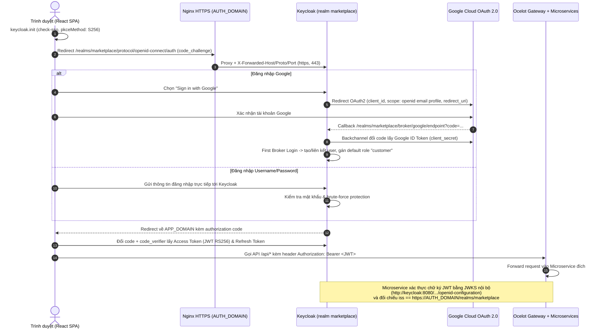
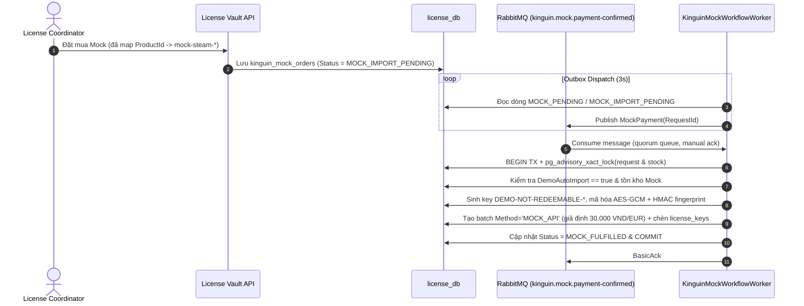
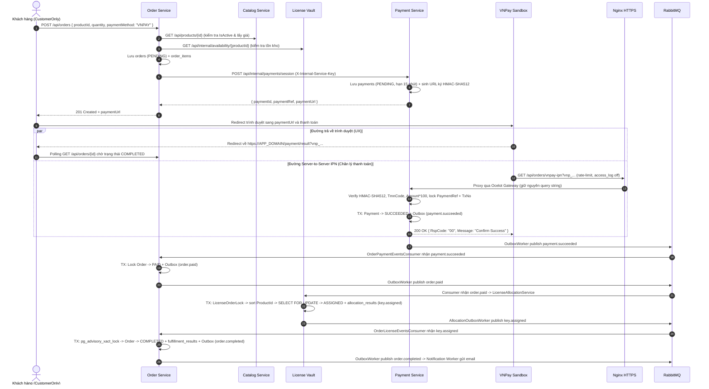
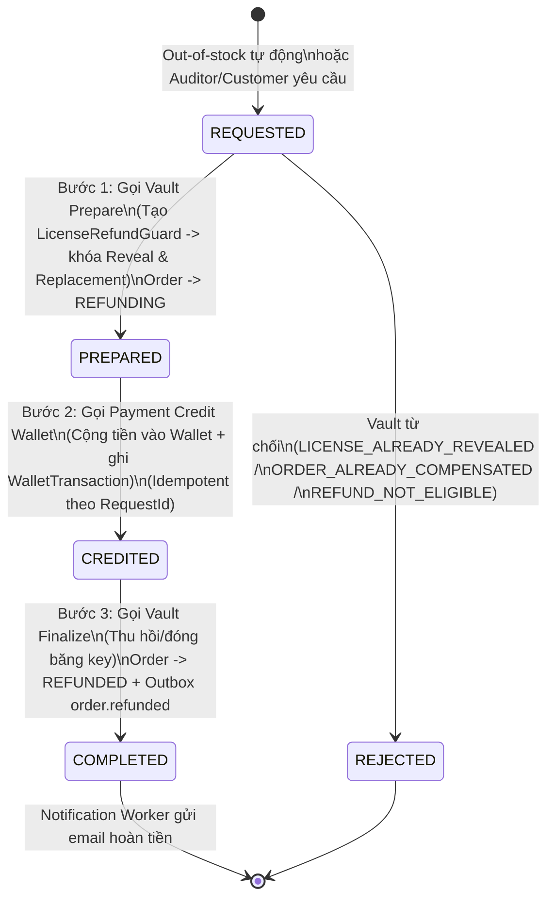
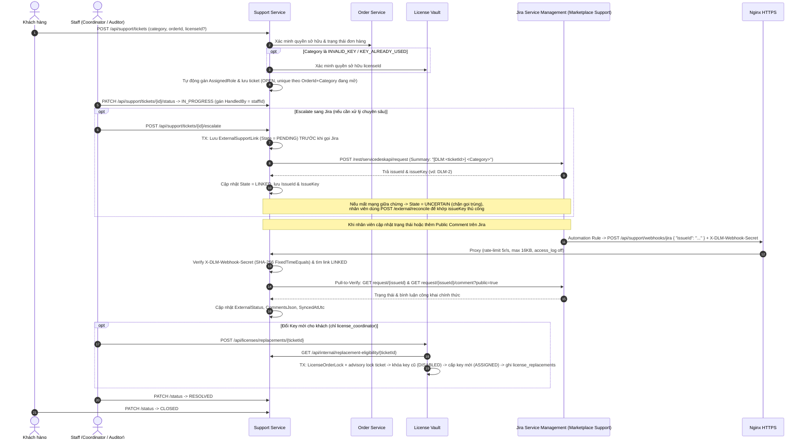

# Chi tiết Toàn bộ Luồng Hoạt động (End-to-End System Flows)

> Tài liệu mô tả từng bước hoạt động thực tế trong mã nguồn của **9 luồng nghiệp vụ & kỹ thuật cốt lõi** và **Topology RabbitMQ** trên Digital License Marketplace (triển khai trực tiếp qua Nginx HTTPS trên VPS, không dùng Cloudflare).

---

## Luồng 1: Đăng nhập (Tài khoản thường & Google OAuth qua Keycloak + PKCE)

Keycloak đóng vai trò Identity Provider (IdP) trung tâm và Identity Broker cho Google. Frontend **không bao giờ giữ mật khẩu hay Google Client Secret**.

**Điểm kỹ thuật cần nhớ:**
- `frontend/src/auth/keycloak.ts` dùng PKCE `S256` vì `marketplace-web` là public client chạy trên trình duyệt.
- `shared/Infrastructure/Security/KeycloakAuthentication.cs` tách `Keycloak:MetadataAddress` (nội bộ `http://keycloak:8080/...`) và `Keycloak:Issuer` (công khai `https://<AUTH_DOMAIN>/realms/marketplace`). Nếu 2 cấu hình không khớp `KC_HOSTNAME`, mọi API sẽ trả `401 Unauthorized`.
- `AuthProvider.tsx` tự gọi `updateToken(30)` trước khi token hết hạn 30 giây và ánh xạ `realm_access.roles` để điều khiển thanh điều hướng & `RoleGuard`.

---

## Luồng 2: Quản lý Catalog & Nhập Metadata Game (Steam / IGDB)

1. `catalog_manager` gọi `GET /api/catalog/steam-import/preview?appId=<steamAppId>` qua Gateway -> `catalog:8080/api/steam-import/preview`.
2. `SteamMetadataProvider` gọi outbound HTTPS tới `https://store.steampowered.com/` (timeout 15s, tắt auto-redirect để tránh SSRF) để lấy tên, mô tả, thể loại, ảnh bìa (tùy chọn fallback sang `IgdbMetadataProvider` nếu cấu hình `IGDB_CLIENT_ID`/`IGDB_CLIENT_SECRET`).
3. Nhân viên rà soát giá bán VND và bấm lưu -> `POST /api/catalog/steam-import` hoặc `POST /api/catalog/products` (`[Authorize(Policy = "CatalogManagerOnly")]`).
4. `CatalogService` kiểm tra trùng `Slug`, lưu vào `catalog_db.products`.
5. Storefront công khai gọi `GET /api/catalog/products` (`[AllowAnonymous]`) — chỉ trả các sản phẩm `IsActive = true`.

---

## Luồng 3: Nhập kho License Key (Thủ công / CSV / TXT & Kinguin Mock Auto-Import)

### 3A. Nhập kho thủ công hoặc file CSV/TXT
1. `license_coordinator` chọn sản phẩm Catalog, nhà cung cấp đang hoạt động (`suppliers.IsActive = true`), mã lô (`Reference`), giá vốn (`UnitCostVnd`), rồi nhập tay hoặc kéo thả file CSV/TXT.
2. Frontend preview định dạng file (`licenseFilePreview.ts`) — **chỉ kiểm tra sơ bộ ở client**, mọi kiểm tra chính thức nằm ở backend.
3. Backend (`LicenseService.cs` trong `license-vault-service`):
   - Xác minh sản phẩm tồn tại ở Catalog (`CatalogClient`).
   - Với từng key: tính `KeyFingerprint = HMAC-SHA256(LICENSE_FINGERPRINT_KEY, key.Trim())` để lọc key trùng trong file và trùng với DB (`UNIQUE INDEX` trên `license_keys.KeyFingerprint`).
   - Mã hóa key bằng **AES-256-GCM** (`LICENSE_ENCRYPTION_KEY`).
   - Tạo bản ghi lô `license_import_batches` (bảo toàn `SupplierName` tại thời điểm nhập) và chèn các dòng `license_keys` trạng thái `AVAILABLE`.

### 3B. Nhập kho tự động qua Kinguin Mock (chỉ cho DB demo)

> **An toàn tách kho:** `LicenseAllocationService` và `LicenseReplacementController` **chỉ cho phép cấp key có `Method = 'MOCK_API'`** khi đồng thời `Kinguin:Mode == "Mock"` và `Kinguin:DemoAutoImport == true`. Trên môi trường thương mại, key mock không bao giờ lọt vào đơn khách thật.

---

## Luồng 4: Mua hàng & Thanh toán qua VNPay Sandbox

**Lưu ý quan trọng:**
- `VNPAY_RETURN_URL` chỉ để hiển thị giao diện kết quả cho khách hàng (`PaymentResultPage` sẽ poll `GET /api/orders/{id}`). **Hệ thống KHÔNG BAO GIỜ tin query string từ trình duyệt để chốt đơn** — chỉ **IPN server-to-server** đã xác thực HMAC-SHA512 mới được phép chuyển trạng thái `PAID`.
- Nếu khách bấm hủy hoặc thanh toán thất bại, Payment phát `payment.failed` -> Order chuyển `PENDING` sang `CANCELED`.

---

## Luồng 5: Mua hàng & Thanh toán qua Marketplace Wallet

Luồng này không cần VNPay và có thể dùng để kiểm thử E2E độc lập:

1. `POST /api/orders` với `paymentMethod: "WALLET"` -> Order kiểm tra Catalog + tồn kho Vault, tạo đơn `PENDING` với `PaymentRef = "W" + OrderId.ToString("N")`, **chưa trừ tiền ví ngay khi tạo đơn**.
2. Khách xác nhận thanh toán -> `POST /api/orders/{id}/pay`.
3. `OrderManager` kiểm tra idempotency (`FindWalletPaymentAsync`), kiểm tra lại Catalog + tồn kho, rồi gọi nội bộ `PaymentService` (`WalletPaymentService.PayAsync`).
4. Trong **1 DB transaction duy nhất** ở `payment_db`:
   - `pg_advisory_xact_lock("payment:{orderId}")` + `SELECT ... FOR UPDATE` trên `payments` và `wallets`.
   - Kiểm tra chưa quá hạn 15 phút và `wallet.Balance >= order.TotalAmount`.
   - Trừ `wallet.Balance`, ghi lịch sử `wallet_transactions (Purchase)`, ghi `payments (SUCCEEDED)`, ghi `outbox_messages (payment.succeeded)` rồi `COMMIT`.
5. Từ sự kiện `payment.succeeded` trở đi, luồng chạy giống hệt Luồng 4: `Order -> PAID -> order.paid -> License Vault -> key.assigned -> Order COMPLETED -> Notification Email`.

---

## Luồng 6: Giao & Xem License Key (`Reveal`)

Xem `services/license-vault-service/Controllers/CustomerLicensesController.cs`:

1. Khách hàng mở trang "My Licenses" -> `GET /api/licenses/me` (`[Authorize(Policy = "CustomerOnly")]`, `Cache-Control: no-store`).
   - License Vault lấy các key thuộc `CustomerId == sub`, trạng thái `ASSIGNED`, không có trong `license_refund_guards`.
   - Gọi sang Order Service (chuyển tiếp Bearer token của chính khách hàng) để xác minh đơn hàng thực sự đang ở trạng thái `COMPLETED` và khớp `OrderItemId` + `ProductId`. **Trả metadata (KHÔNG trả plaintext key).**
2. Khách bấm "Hiển thị Key" -> `POST /api/licenses/me/{id}/reveal`:
   - Xác minh đơn hàng `COMPLETED` với Order Service.
   - Mở transaction trên `license_db` -> khóa `LicenseOrderLock.AcquireAsync(db, orderId)`.
   - Kiểm tra `license_refund_guards`: nếu đơn đang trong luồng hoàn tiền, từ chối `409 LICENSE_REFUND_LOCKED`.
   - `SELECT * FROM license_keys WHERE Id = @id AND CustomerId = @sub AND Status = 'ASSIGNED' FOR UPDATE`.
   - Giải mã `EncryptedKey` bằng `LicenseEncryption.Decrypt()` (AES-256-GCM).
   - Ghi nhận mốc mở key đầu tiên `RevealedAtUtc ??= DateTime.UtcNow` và **`COMMIT` transaction trước khi trả plaintext** cho trình duyệt!
   - Vì `RevealedAtUtc` đã được ghi bền vững trước khi khách nhìn thấy key, khách không thể lợi dụng lỗi mạng để vừa lấy được key vừa yêu cầu hoàn tiền kiểu `UNREVEALED`.

---

## Luồng 7: Hoàn tiền Tự động & Thủ công (Refund Saga)

Hệ thống hỗ trợ 3 chế độ hoàn tiền về **Marketplace Wallet** (không gọi hoàn tiền ngân hàng thật):
- **`OUT_OF_STOCK` (tự động):** Khi đơn đã `PAID` nhưng License Vault hết hàng và phát `key.out_of_stock`, `OrderFulfillmentService` tự động tạo `refund_operations` (`Status = REQUESTED`, `RequestedBy = SYSTEM`).
- **`UNREVEALED` (thủ công/tự phục vụ theo chính sách):** Đơn đã `COMPLETED` nhưng khách chưa bao giờ bấm `Reveal` key.
- **`VERIFIED_DEFECT` (thủ công qua Support/Auditor):** Key bị xác minh lỗi và đủ điều kiện hoàn tiền.

**Kỹ thuật Saga trong `RefundOrchestrator.cs`:**
- `RefundWorker` chạy nền, lấy từng dòng `refund_operations` bằng `FOR UPDATE SKIP LOCKED`.
- Nếu bất kỳ bước HTTP nội bộ nào mất mạng/timeout, worker tăng `RetryCount` và hẹn lại theo `RetryDelay.Seconds(retryCount)` — tất cả 3 API nội bộ (Vault Prepare, Payment Credit, Vault Finalize) đều **idempotent theo `RequestId`**, đảm bảo không bao giờ cộng tiền ví 2 lần!

---

## Luồng 8: Hỗ trợ Khách hàng, Đổi Key & Đồng bộ 2 chiều Jira Service Management

**Phân tuyến Category -> Role (`SupportController.cs`):**
- `INVALID_KEY`, `KEY_ALREADY_USED`, `KEY_NOT_RECEIVED` → `license_coordinator`
- `PAYMENT_ISSUE`, `REFUND_REQUEST`, `OTHER` → `transaction_auditor`

---

## Luồng 9: Gửi Email Thông báo Bất đồng bộ (Notification Service)

1. `Order Service` hoàn tất đơn (`order.completed`) hoặc hoàn tiền xong (`order.refunded`) -> ghi vào `order_db.outbox_messages` -> `OutboxWorker` publish lên RabbitMQ exchange `marketplace.events`.
2. `NotificationConsumer` (trong `services/notification-service`) nhận message từ quorum queue `notification.order-events`:
   - Kiểm tra email hợp lệ và `CustomerEmailVerified == true` (nếu không hợp lệ thì ghi trạng thái `SKIPPED` hoặc bỏ qua an toàn).
   - Chèn vào `notification_db.notification_messages` với ràng buộc `UNIQUE ("OrderId", "Type")`, trạng thái `PENDING`, rồi `BasicAck` lên RabbitMQ.
3. `EmailWorker` chạy nền, lấy từng dòng `PENDING` có `NextRetryAtUtc <= now` bằng `SELECT ... FOR UPDATE SKIP LOCKED`:
   - `EmailSender` kết nối Gmail SMTP (TLS cổng 587) với timeout 30s.
   - **Nội dung email** chỉ thông báo mã đơn hàng, số tiền và hướng dẫn khách đăng nhập DLM để mở key (hoặc thông báo đã cộng tiền vào Marketplace Wallet) — **tuyệt đối không gửi key plaintext qua email**.
   - Nếu gửi thành công -> `SENT`; nếu lỗi SMTP -> tăng `RetryCount` (tối đa 5 lần, delay `15s, 30s, 60s, 120s, 240s`), quá 5 lần -> `FAILED`.

---

## Phụ lục: Tổng hợp RabbitMQ Topology

Exchange chính: **`marketplace.events`** (type `topic`, `durable: true`)  
Dead Letter Exchange: **`marketplace.events.dead`** (áp dụng policy `delivery-limit: 5`, `overflow: reject-publish` trong `scripts/configure-rabbitmq.sh`)

| Routing Key | Publisher | Queue (Quorum) | Consumer | Ý nghĩa |
|---|---|---|---|---|
| `payment.succeeded` | Payment Service | `order.payment-events` | Order Service | Thanh toán VNPay hoặc Wallet thành công |
| `payment.failed` | Payment Service | `order.payment-events` | Order Service | Thanh toán VNPay thất bại / bị hủy |
| `payment.refunded` | Payment Service | `order.payment-events` | Order Service | Đã cộng tiền hoàn vào Wallet |
| `order.paid` | Order Service | `license-vault.order-paid` | License Vault | Yêu cầu cấp phát License Key cho đơn đã thanh toán |
| `key.assigned` | License Vault | `order.license-events` | Order Service | Đã khóa và gán đủ LicenseId (không chứa plaintext key) |
| `key.out_of_stock` | License Vault | `order.license-events` | Order Service | Hết kho -> Order tự tạo Refund Saga `OUT_OF_STOCK` |
| `order.completed` | Order Service | `notification.order-events` | Notification Worker | Gửi email thông báo đơn hoàn tất |
| `order.refunded` | Order Service | `notification.order-events` | Notification Worker | Gửi email thông báo đã hoàn tiền về Wallet |
| `kinguin.mock.payment-confirmed` | License Vault (Dispatch) | `license-vault.kinguin-mock-payment` | License Vault (Worker) | Xử lý bất đồng bộ đơn mua Kinguin Mock & Auto-Import demo |
